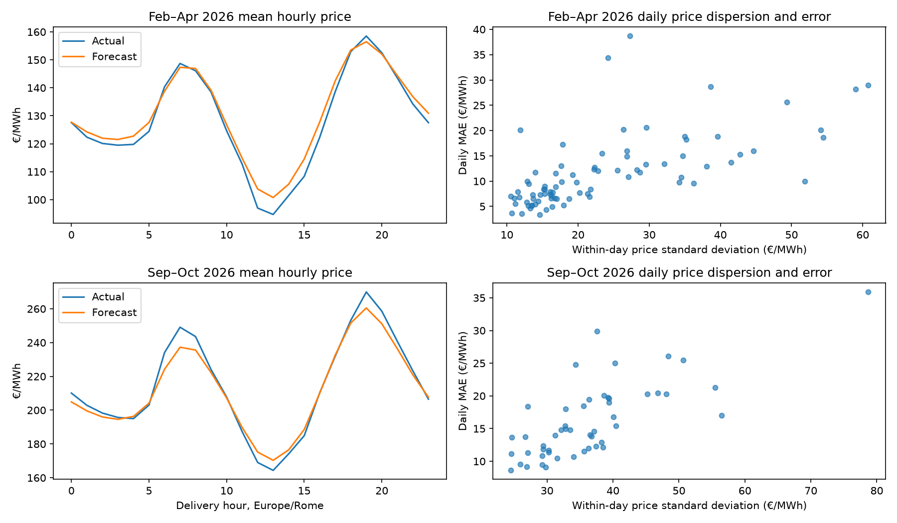

# Price forecast failure modes and the midday solar hypothesis

This is an exploratory decomposition, not a causal attribution or a final
model evaluation. Price WAPE is total absolute error divided by total absolute
observed price; bias is forecast minus actual. Times are Europe/Rome. The
periods have been repeatedly examined during model development. Historical
auction publication times are partly assumed, and the Open-Meteo archives are
classified as operational forecasts or hindcasts with unverified vintage.

## Day-ahead: midday and volatile-day errors

The early sample uses 82 shared February–April 2026 days from the
recency-weighted interaction model with past IDA prices and regional weather.
The later sample uses 50 shared September–October days from the unweighted
weekly-refitted interaction model with the same feature family. These are
different models and samples; the comparison is descriptive, not a paired
seasonal experiment. DST and incomplete days affect coverage.

| Sample | Mean DA price 00–05 | 06–11 | 12–17 | 18–23 | Midday MAE | Midday bias |
| --- | ---: | ---: | ---: | ---: | ---: | ---: |
| February–April | 122.28 | 135.17 | 110.42 | 144.87 | 17.12 | +5.41 |
| September–October | 200.83 | 224.32 | 189.13 | 242.04 | 19.70 | +3.09 |

Values are EUR/MWh. Midday was below the morning on 78 of 82 early days and
all 50 later days. In the later sample, Monday, Saturday and Sunday interval
MAE were respectively 19.95, 18.54 and 19.47 EUR/MWh; Friday was 12.02.
These small, selected day groups cannot establish a stable weekday effect.

The five highest daily MAEs in the early sample occurred on March 4 (38.68),
April 13 (34.35), April 25 (28.98), March 24 (28.71), and March 29 (28.13).
Their mean signed errors were respectively -38.68, -21.42, -3.55, +28.71 and
+0.94 EUR/MWh: some are predominantly level errors, others involve shape.
March 29 has 92 products because of daylight saving time. Later worst days
were September 13 (35.90), September 14 (29.87), October 11 (26.09),
September 12 (25.47) and October 19 (25.03). Daily MAE correlated with
within-day realized price standard deviation at 0.65 early and 0.74 later.
Both use realized prices and are diagnostic, not forecast-time features.

## Solar association and targeted tests

Regional radiation is the mean of the four forecast shortwave features used
by the model, averaged over 12–17. The daily difference is mean realized
18–23 price minus mean realized 12–17 price. Correlation with radiation is
0.80 in February–April and 0.51 in September–October. In February–April the
lowest-radiation day quartile averaged 185 W/m² and a 5.3 EUR/MWh price
difference; the highest averaged 606 W/m² and a 75.0 EUR/MWh difference.
The model's mean midday bias rose from -1.9 to +14.1 EUR/MWh across those
quartiles. In September–October, the corresponding price differences were
32.8 and 70.8 EUR/MWh but the model's bias remained around +3 EUR/MWh.
Radiation is a proxy for solar conditions, not measured total solar output;
season, demand, fuel prices and other drivers can confound these associations.

A targeted pilot augments the recency-weighted model with piecewise-linear
radiation terms. The three thresholds come from training-period daylight
radiation quantiles and are interacted with delivery time by the existing
model. On the already-examined February–April days, baseline MAE/WAPE were
11.711 EUR/MWh/9.136%, versus 11.682 EUR/MWh/9.113% with the added terms;
midday bias fell from +5.407 to +5.321 EUR/MWh. This is a small exploratory
change, not evidence of general improvement. The queued weekly May–August
replay estimates each threshold again at every refit using only its training
rows. The exact saved-matrix columns and hashes are recorded by
`scripts/analyze_price_solar_response.py`; the 2026 delivery periods are not
an untouched final holdout.

The May–August rolling baseline has finished on 107 complete shared days;
the solar-hinge predictions are still running. Some solar-hinge refits have
emitted convergence warnings at the configured 5,000-iteration limit; their
results are diagnostic until convergence is resolved and re-evaluated. The
baseline's mean midday signed error
was -9.22 EUR/MWh in May (27 days), -13.68 in June (29), -0.84 in July (29)
and +9.19 in August (22). Mean midday errors within a month are descriptive
and do not establish why the bias changes. Across these summer days, the
correlation between midday radiation and midday bias was only 0.18. This
variation cautions against extrapolating the early-period radiation pattern
or applying a fixed directional adjustment.

A second search compared one, two and three delivery-time harmonics with
recency weighting, motivated by the large midday shape error. All 12 fits
completed without recorded failures or convergence warnings. At the best
2,880-observation half-life, one, two and three harmonics scored respectively
11.711, 11.766 and 12.030 EUR/MWh MAE with prior IDAs and weather, and
11.796, 11.837 and 12.168 with weather without prior IDAs. The more flexible
models did not improve on the matched one-harmonic model in early selection;
they were not promoted to later replays. Prior experiments adding weekday
terms and unweighted higher harmonics produced only small or uncertain gains.
The piecewise solar response still requires its later matched-baseline replay
before it can be considered useful.

## Intraday: different failure modes

For the May–August retrospective replay, the weather-feature IDA1 model had
its largest MAE in the 18–23 block (7.35 EUR/MWh); IDA2 was largest at 00–05
(9.35); IDA3 only covers 12–23 and had 14.50 in 12–17 versus 11.84 in
18–23. IDA3's large daily signed errors include June 26 (+30.08) and August
31 (-29.84), suggesting days where the entire submitted window shifted
relative to the model. Correlations of daily error with same-day price
standard deviation were only 0.10, 0.02 and -0.12 for IDA1, IDA2 and IDA3,
so the DA dispersion association should not be assumed to apply to IDAs.
Latest-cleared-price baselines and paired uncertainty remain essential; see
[the bidirectional IDA comparison](price_ida_latest_bidirectional_2026.md).
